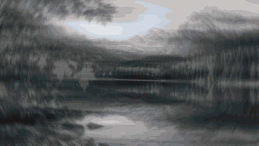

# colorize

黑白 → 彩色的上色转场：画面先是黑白并带旋转模糊，彩色从左向右扫入，伴随水平动感模糊，旋焦从中心向外逐圈回正，最后留下柔和的丁达尔光晕。

复刻剪映「单彩渐变 + 动感模糊 + 丁达尔旋焦」组合，用 Python + OpenGL 独立渲染，不依赖剪映。图片、视频、iPhone 实况照片（Live Photo）、安卓动态照片都能直接用。



## 安装

```bash
npx skills add vibe-motion/colorize
```

也收录在 [vibe-motion/skills](https://github.com/vibe-motion/skills) 合集中。

安装后对智能体说：

```text
用 $colorize 把这张照片做成黑白到彩色的上色视频：/path/to/photo.jpg
用 $colorize 把这几张实况照片拼成一条竖屏上色短片
```

## 直接运行

```bash
python3 -m pip install -r scripts/requirements.txt   # numpy, moderngl, Pillow
python3 scripts/colorize.py photo.jpg -o out/photo.mp4
```

需要 `ffmpeg` / `ffprobe` 和支持 OpenGL 3.3 的环境。读取 HEIC 需要 `pillow-heif`、macOS 自带的 `sips`，或支持 HEIF 的 `ffmpeg`。

| 输入 | 处理方式 |
| --- | --- |
| 图片 | 静态底图，`--duration` 秒内完成上色，`--hold` 秒停留在最终画面 |
| 视频 | 画面保持运动，前 `--duration` 秒上色，其余保持最终效果，保留音频 |
| 实况照片 | 传 `IMG_0001.HEIC`，同名 `IMG_0001.MOV` 自动作为动态部分，含声音 |
| 安卓动态照片 | 传 `.jpg`，自动提取内嵌 MP4 |
| 多个输入 | 依次渲染，拼成一个 MP4 |

```bash
python3 scripts/colorize.py IMG_0001.HEIC -o out/live.mp4                         # 实况照片
python3 scripts/colorize.py clip.mov --duration 3 -o out/clip.mp4                  # 视频，3 秒上色
python3 scripts/colorize.py a.jpg b.heic c.mov --size 1080x1920 -o out/reel.mp4    # 竖屏合集
python3 scripts/colorize.py photo.jpg --set angle=0.09 --set bloom=0.7             # 加强旋焦和光晕
```

参数说明见 [SKILL.md](SKILL.md)。

## 说明

- 默认参数用银杏、红枫两张静态照片对剪映导出逐帧拟合，草地照片做独立验证；1080p 缩到 480×270 后平均 SSIM 约 0.96。几何采样和光晕是近似复刻，不保证与剪映逐像素一致。
- `assets/effect_maps/` 中的颜色查找表与焦点遮罩取自剪映效果包，仅供学习研究。
